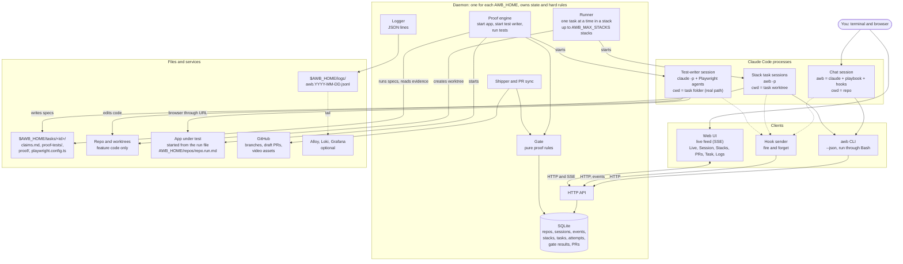
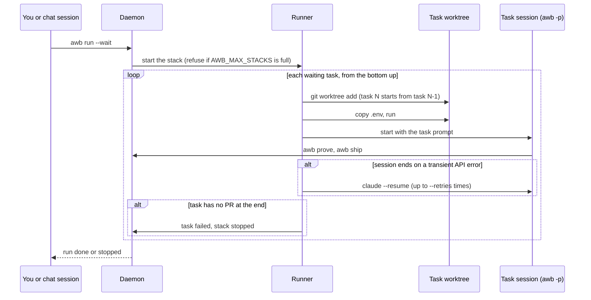
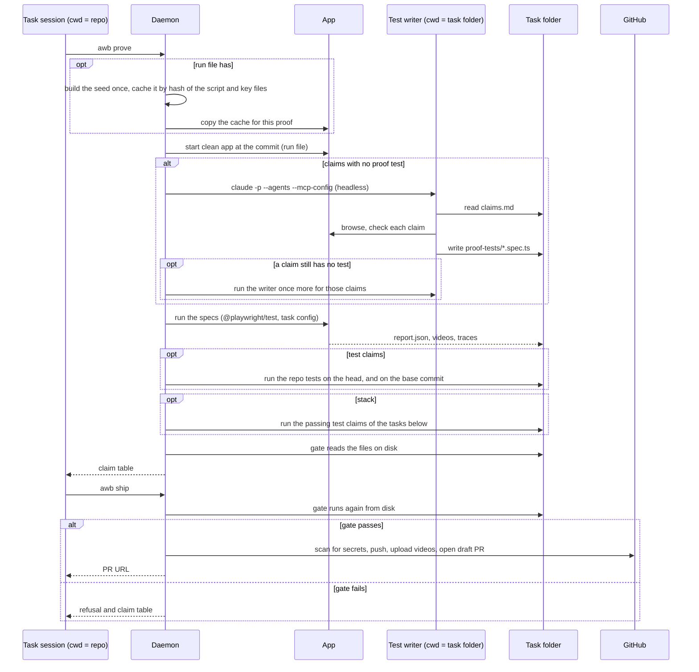

# Agent Workbench architecture

The first design is in `archive/v6-build/PROPOSAL.md`. This file shows the system as built.

## System

The test writer has no link to the repo. Its working folder is the task folder, so the Playwright save tools write there, and it cannot read the source. It reaches the app only through the URL.

Every part writes to the log. One file holds one UTC day. The Logs tab and `awb logs` read the files. `awb doctor` checks that Alloy and Loki are current when they run.

## Stack run: `awb run`

`awb stop` ends the run and the proof of the current task. The task becomes `failed` with the reason `stopped by awb stop`, and the later tasks stay `waiting`. `awb retry` sets a failed task back to `waiting` and starts the runner again, in the same worktree and branch.

## Proof flow: `awb prove` and `awb ship`

The gate refuses in these cases:
- A claim has no test, or its test is skipped or not passed.
- A browser claim has no video or no trace.
- A test claim also passes on the base commit.
- A carried claim of a task below no longer passes.
- The commit or a proof test file changed after the run started, or the source has uncommitted changes.

The test writer runs under a time limit. In a task session, it gets only the time left in the task session.
