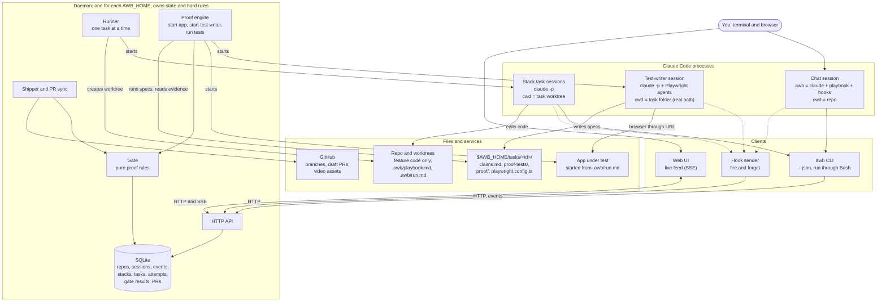
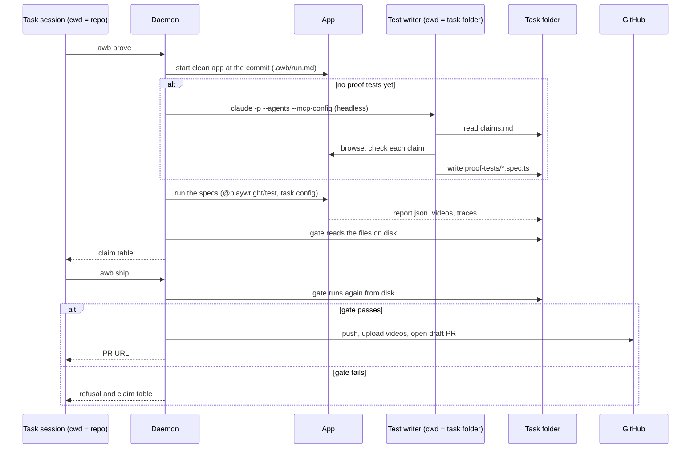
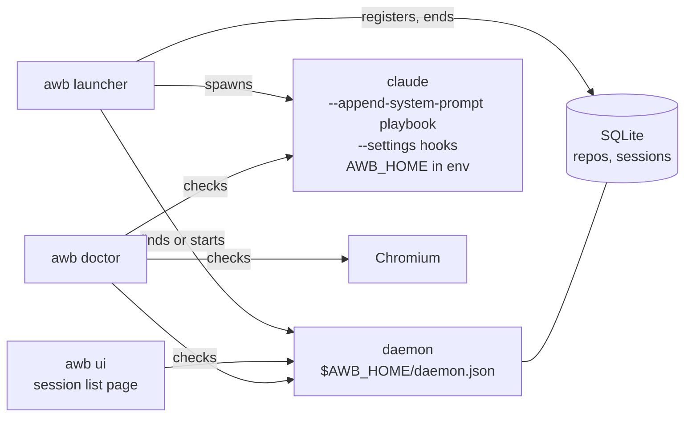

# Agent Workbench v6 architecture

These diagrams follow `PROPOSAL.md` sections 3 and 4. Section 6.3 holds the phase 0 facts that shaped them.

## System

The test writer has no link to the repo. Its working folder is the task folder, so the Playwright save tools write there, and it cannot read the source. It reaches the app only through the URL.

## Proof flow: `awb prove` and `awb ship`

## Phase 1 scope

Phase 1 builds only part of the system diagram:

